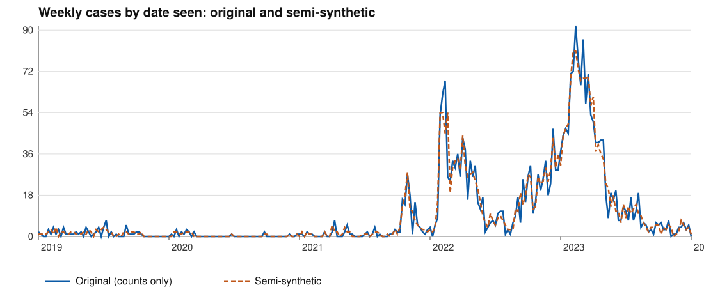

# Measles in Sierra Leone, 2019 to 2023: a semi-synthetic teaching file

A worked example for [Fieldwork](https://github.com/digital-twin-ph/fieldwork), **in progress**: the data are here and
the workflows are not yet built.

**This is not surveillance data, and no row is a person.** It is made from a measles line list that the Sierra Leone
Field Epidemiology Training Program (FETP) produced for training. Before anything was kept here it was de-identified
and made semi-synthetic by [scripts/make_semisynthetic.py](scripts/make_semisynthetic.py). The original is not in this
repository's files.

## What was done to it

| Step | Why |
| --- | --- |
| The four address columns are removed (places travelled to, and the addresses of contacts and of a pregnant contact) | They held street addresses and a name |
| Date of birth is removed, and age in months and days; age in years is kept | With sex and facility, an exact date of birth made 90% of rows unique |
| The travel and contact dates are removed, and "District where symptoms started" | Each date was filled for under twenty rows; the district was empty in every row |
| **Whole records are swapped**: age, sex, status, symptoms, lab result, doses, case definition and their dates move together to another record of the same residential district and month seen (widened to the quarter, year, country's month, then the whole file, until each group has two or more). No record keeps its own details where there is another to swap with | A row at a clinic and week carries another child's details |
| Each visit is moved by up to seven days either way, at random, with its other dates | "A measles case was seen at this clinic this week" is no longer true of whoever was there |
| Every date is the Monday that starts its week (ISO 8601) | Days are not needed for an epidemic curve by week |

The swaps and moves use a fixed seed, so the script gives the same file every time from the same original.

**Kept exactly:** the number of cases by residential district and by facility, and the totals of age, sex, lab results,
status and case definition over the whole file. **Approximate, by design:** counts by week. **Not true of any child:**
any one row's combination of details.

## How close it is to the original

| Comparison | Correlation | Cases in another period | Peak, original and semi-synthetic |
| --- | --- | --- | --- |
| Weekly, by date seen | 0.968 | 11.2% | 13 Feb 2023 (92); 6 Feb 2023 (81) |
| Weekly, four-week rolling mean | 0.996 | 4.4% | 6 Mar 2023 (80); 20 Feb 2023 (76) |
| Weekly, by onset | 0.956 | 12.5% | 30 Jan 2023 (75); 30 Jan 2023 (74) |
| Monthly | 0.983 | 6.5% | Mar 2023 (313); Feb 2023 (303) |
| District and month | 0.972 | 8.8% | Western Area Urban: Mar 2023 (138); Feb 2023 (120) |
| District, whole period | identical | 0% | |
| Facility and year | 1.000 | 0.9% | |
| Age band and year | 1.000 | 1.0% | |

The two waves keep their timing and size, and where cases were and who they were is kept. Weekly peaks are lower and
spread by about a week, which is the move doing its work: an exercise on the exact peak week or a weekly alert
threshold would answer differently from the original; one by onset or by month would not. The chart is drawn from
weekly counts only.

## The file

[data/measles-sierra-leone-semisynthetic.csv](data/measles-sierra-leone-semisynthetic.csv): 2,606 rows, 31 columns,
one per suspected measles case seen from January 2019 to December 2023, most of them in 2022 and 2023. The first,
**Case number** (SL-0001 to SL-2606), is added here, in an order drawn from its own seed, so two cases with the same
details can be told apart; it says nothing about where a record stood in the original. The rest are as the source's
export named them: an organisation unit (the facility, by name), residential district, age in years, sex,
dates of onset, being seen, specimen and result, symptoms, routine doses, lab result and whether the case met the
definition.

**What it says about itself, as found:** about 18% of rows have no residential district; most clinical fields are
empty for most rows (a lab result for 570 of 2,606); one age over 100 comes from a date of birth entered in 1904; one onset
falls before 2019, in 2017. These are kept as found, to be named as data quality findings, not repaired.

## Workflows

Open [fieldwork-project.json.gz](fieldwork-project.json.gz) in Fieldwork, or build it from an empty canvas by following
[manual.json](manual.json), which Fieldwork shows in its Manual tab. Each reads the line list from this repository at
a fixed commit.

| Workflow | What it shows |
| --- | --- |
| How did the outbreak unfold, month by month? | Suspected cases by month of onset, 2019 to 2023: two waves, early 2022 and early 2023. Cases with no onset (389) or one outside the visits' span (2) are left out by Select rows, which says how many. By month, because five years of weeks is more than a chart here draws |
| Where were the cases seen? | The facility each case names, found in GRID3's register of Sierra Leone's health facilities (CC BY 4.0) by Find health facilities from a list. Facilities with fewer than ten cases are counted, not mapped; the rest are coloured by band, 10 to 49 or 50 or more |

**Not yet:** cases by district on a map, and the case classification by WHO's definition, which waits on the FETP's
data dictionary for one column.

## Use

For teaching: an epidemic curve, cases by district, the share meeting the case definition and with a lab result, and
whether facility names can be matched to an open facility list. Maps should show counts by district, or by facility
only where a count is large enough not to point at one child.

## Source, terms and credit

**Original data:** a measles line list produced by the Sierra Leone Field Epidemiology Training Program (FETP).

**Terms:** used with the Sierra Leone FETP's agreement for the development of distributable training materials. **This
data set has been modified for use on a public teaching repository**: de-identified and made semi-synthetic, as
described above. Its use is for teaching and training; no row is a person and the file is not surveillance data.

**Credit.** This is a derived data set with two contributions:

| Contribution | By |
| --- | --- |
| The original line list | Sierra Leone Field Epidemiology Training Program |
| De-identification, and making it semi-synthetic (`scripts/make_semisynthetic.py`) | The Fieldwork project, [digital-twin-ph](https://github.com/digital-twin-ph) |

Cite both, as [CITATION.cff](CITATION.cff) lists them.
